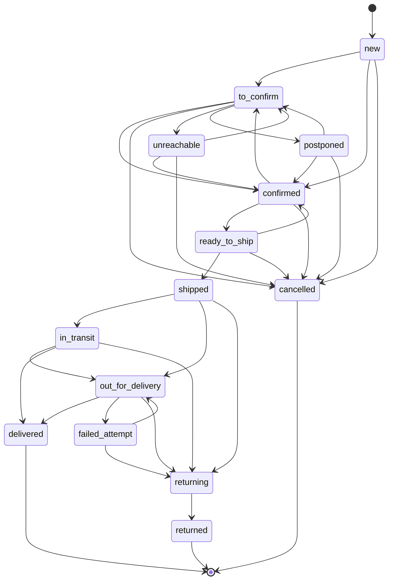

# Order statuses

Source of truth: `packages/contracts/src/orders/order-status.ts` (`ORDER_TRANSITIONS`). The API rejects any move not listed there with `orders.illegal_transition`.

Notes:

- `unreachable -> unreachable` is allowed so each failed call attempt is recorded in the history.
- `in_transit -> delivered` covers stop-desk pickups, which carriers often report without an "out for delivery" scan.
- After `shipped`, an order can no longer be cancelled, only returned.
- Orders are editable (items, customer, prices) only in `new`, `to_confirm`, `unreachable`, `postponed` and `confirmed`.
- Amounts are whole dinars; `codAmount = subtotal + shippingFee - discount` is computed by the server.
